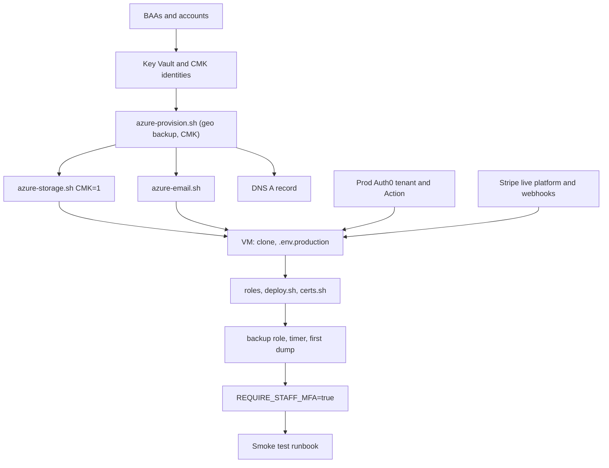

# Production infrastructure runbook

The order of operations for standing up a fresh production stack, separate from dev
(`nio2-rg`, dev.qinio.co). Each step names the script or `COMMANDS.md` section that does the work
and ends with a one-line check. Do not move on until the check passes.



Rules that apply throughout:

- Never paste a secret into this file, a ticket, chat, or shell history. Generate secrets on the
  machine that uses them.
- Use a **separate checkout** for production operations. The provisioning scripts write `PREFIX`,
  `LOCATION`, and the database administrator password into `deploy/.azure-secrets`, and running
  them for production from the dev checkout overwrites the dev values:
  ```bash
  git clone git@github.com:MisterCode415/niotech.git ~/sites/nio-platform-prod
  cd ~/sites/nio-platform-prod
  ```
- Nothing in this runbook touches the dev resource group.

## 0. Prerequisites

Have all of these before creating anything:

- [ ] Signed **BAA with Microsoft**. It covers Azure, including Communication Services email.
  Confirm in the Microsoft Service Trust Portal that it applies to the subscription you will use.
- [ ] A signed BAA with every AI provider you plan to mark **Approved for PHI**. Providers without
  one must stay unapproved.
- [ ] A **production Auth0 tenant**, for example `qinio.us.auth0.com`. Do not reuse `qinio-dev`. Use
  a plan that includes MFA and Organizations, and sign Auth0's BAA if they offer one on your plan.
- [ ] A **live-mode Stripe platform account** with Connect enabled and written approval for the
  health-testing business model (see the last item in `STRIPE_CONFIG.md`).
- [ ] The production hostname and access to its DNS, for example `app.qinio.co`.
- [ ] Azure CLI signed in as an Owner on the subscription (`az login`), the Auth0 CLI, and an SSH
  key pair.

Check: `az account show --query name -o tsv` prints the production subscription.

## 1. Names and variables

Set these in every shell you use for production work:

```bash
export PREFIX=qinio-prod
export RG="${PREFIX}-rg"
export LOCATION=eastus2            # pick a region with a paired region (eastus2 pairs with centralus)
export PAIRED_LOCATION=centralus
export APP_HOST=app.qinio.co
export VM_USER=azureuser
export ADMIN_CIDR="$(curl -fsS https://ifconfig.me)/32"

export SUFFIX="$(az account show --query id -o tsv | tr -d '-' | cut -c1-6)"
export CLEAN_PREFIX="$(tr -dc 'a-z0-9' <<<"$PREFIX")"
export KV_NAME="${CLEAN_PREFIX}kv${SUFFIX}"          # same name azure-storage.sh uses, so it reuses this vault
export KV_PAIRED="${CLEAN_PREFIX}kv2${SUFFIX}"       # paired-region vault for geo-redundant backup
```

What differs from dev:

| Setting | Dev | Production |
|---|---|---|
| Resource group | `nio2-rg` | `qinio-prod-rg` |
| Hostname | dev.qinio.co | `$APP_HOST` |
| Postgres geo backup | Disabled (server predates it) | Enabled |
| Encryption keys | Microsoft-managed | Customer-managed (Key Vault) |
| Auth0 tenant | qinio-dev | production tenant |
| Stripe | test mode | live mode |
| Simulation buttons | on | off |
| Staff MFA | opt-in | required |

`azure-provision.sh` probes the region before creating anything. If it reports the region is
restricted, choose another region that has a pair and update both `LOCATION` and
`PAIRED_LOCATION`. Common pairs: eastus/westus, eastus2/centralus, northcentralus/southcentralus,
westcentralus/westus2.

Check: `echo "$PREFIX $LOCATION $PAIRED_LOCATION $KV_NAME"` shows the values you expect.

## 2. Key Vault and customer-managed keys for PostgreSQL

The server's encryption key can only be chosen when the server is created, so the keys must exist
before step 3. With geo-redundant backup, Azure also needs a key and an identity in the paired
region.

```bash
az group create -n "$RG" -l "$LOCATION" -o none
ME="$(az ad signed-in-user show --query id -o tsv)"

for pair in "$KV_NAME:$LOCATION" "$KV_PAIRED:$PAIRED_LOCATION"; do
  vault="${pair%%:*}"; region="${pair##*:}"
  az keyvault create -n "$vault" -g "$RG" -l "$region" \
    --enable-rbac-authorization true --enable-purge-protection true --retention-days 90 -o none
  az role assignment create --assignee-object-id "$ME" --assignee-principal-type User \
    --role "Key Vault Crypto Officer" \
    --scope "$(az keyvault show -n "$vault" --query id -o tsv)" -o none
done

az identity create -g "$RG" -n "${PREFIX}-pg-cmk-id" -l "$LOCATION" -o none
az identity create -g "$RG" -n "${PREFIX}-pg-cmk-id-geo" -l "$PAIRED_LOCATION" -o none

for pair in "${PREFIX}-pg-cmk-id:$KV_NAME" "${PREFIX}-pg-cmk-id-geo:$KV_PAIRED"; do
  identity="${pair%%:*}"; vault="${pair##*:}"
  az role assignment create \
    --assignee-object-id "$(az identity show -g "$RG" -n "$identity" --query principalId -o tsv)" \
    --assignee-principal-type ServicePrincipal \
    --role "Key Vault Crypto Service Encryption User" \
    --scope "$(az keyvault show -n "$vault" --query id -o tsv)" -o none
done

sleep 60   # role assignments take a minute to propagate before the key can be created

az keyvault key create --vault-name "$KV_NAME"   -n nio-pg-cmk --kty RSA --size 3072 -o none
az keyvault key create --vault-name "$KV_PAIRED" -n nio-pg-cmk --kty RSA --size 3072 -o none

export PG_CMK_KEY_ID="$(az keyvault key show --vault-name "$KV_NAME" -n nio-pg-cmk --query key.kid -o tsv)"
export PG_CMK_IDENTITY_ID="$(az identity show -g "$RG" -n "${PREFIX}-pg-cmk-id" --query id -o tsv)"
export PG_CMK_BACKUP_KEY_ID="$(az keyvault key show --vault-name "$KV_PAIRED" -n nio-pg-cmk --query key.kid -o tsv)"
export PG_CMK_BACKUP_IDENTITY_ID="$(az identity show -g "$RG" -n "${PREFIX}-pg-cmk-id-geo" --query id -o tsv)"
```

Purge protection cannot be turned off, and deleting or disabling a key makes the server
unreadable. Treat the vaults as production data: no one deletes them, and access is limited to the
Crypto Officer role.

Check: all four `PG_CMK_*` variables are non-empty (`env | grep -c '^PG_CMK_'` prints `4`).

## 3. Provision Azure resources

Run from the production checkout, in the same shell as step 2:

```bash
PREFIX="$PREFIX" LOCATION="$LOCATION" ADMIN_CIDR="$ADMIN_CIDR" \
  PG_GEO_BACKUP=Enabled PG_BACKUP_RETENTION=35 \
  PG_CMK_KEY_ID="$PG_CMK_KEY_ID" PG_CMK_IDENTITY_ID="$PG_CMK_IDENTITY_ID" \
  PG_CMK_BACKUP_KEY_ID="$PG_CMK_BACKUP_KEY_ID" PG_CMK_BACKUP_IDENTITY_ID="$PG_CMK_BACKUP_IDENTITY_ID" \
  ./deploy/azure-provision.sh
```

It creates the network, NSG, VM, private DNS, and a private PostgreSQL Flexible Server, and writes
the administrator password to `deploy/.azure-secrets` (mode 600). Note the VM's public IP from its
summary. If the region rejects geo backup, do not fall back to `PG_GEO_BACKUP=Disabled` without
deciding that the monthly dumps in geo-redundant storage are enough.

Check:

```bash
az postgres flexible-server show -g "$RG" -n "$(az postgres flexible-server list -g "$RG" --query '[0].name' -o tsv)" \
  --query '{geo:backup.geoRedundantBackup,days:backup.backupRetentionDays,key:dataEncryption.type}' -o json
```

This should print `Enabled`, `35`, and `AzureKeyVault`.

Then storage and email:

```bash
PREFIX="$PREFIX" CMK=1 ./deploy/azure-storage.sh
PREFIX="$PREFIX" ./deploy/azure-email.sh
```

- `azure-storage.sh` finds the vault from step 2 by name and adds its own key and identity for the
  two storage accounts. It prints the three storage lines for `.env.production`. Details are in
  [RUNBOOK-backup-restore.md](RUNBOOK-backup-restore.md), section 1a.
- `azure-email.sh` prints the SMTP settings. It uses an Azure-managed sender address
  (`donotreply@<guid>.azurecomm.net`) with low sending limits. For production, add a custom domain
  in Azure Communication Services (`--domain-management CustomerManaged`), publish its SPF and DKIM
  records, and set `SMTP_FROM` to an address on it. See "Azure Communication Services email" in
  `COMMANDS.md`.

Check: `az storage account list -g "$RG" --query '[].{name:name,key:encryption.keySource}' -o table`
shows two accounts with `Microsoft.Keyvault`.

## 4. DNS and VM bootstrap

1. Create the DNS record: `$APP_HOST  A  <VM public IP>`. If you will enable custom tenant domains
   later, also read "Custom domains (white label)" in `COMMANDS.md`; `SERVER_NAME` must then be a
   name tenants can CNAME to.
2. Wait for resolution: `dig +short A "$APP_HOST"` prints the VM IP.
3. On the VM, clone and create the environment file:
   ```bash
   ssh "${VM_USER}@<VM public IP>"
   git clone git@github.com:MisterCode415/niotech.git nio-platform && cd nio-platform
   cp .env.production.example .env.production && chmod 600 .env.production
   ```
4. Fill `.env.production`. Generate every secret on the VM, for example
   `printf 'APP_ENCRYPTION_KEY=%s\n' "$(openssl rand -hex 32)" >> .env.production`, and remove the
   empty placeholder line it replaces.

| Key | Production value |
|---|---|
| `NODE_ENV` | `production` |
| `SERVER_NAME`, `WEB_ORIGIN`, `API_PUBLIC_URL` | `$APP_HOST`, `https://$APP_HOST`, `https://$APP_HOST` |
| `DATABASE_URL` | `nio_app` login, set in step 7, ending `?sslmode=require` |
| `BUNDLED_DB` | `false` |
| `AUTH_PROVIDER` | `auth0` |
| `ALLOW_DEV_AUTH` | `false` |
| `AUTH0_*` (five values) | from step 5 |
| `PLATFORM_ADMIN_EMAIL` | the alpha administrator's email |
| `STORAGE_DRIVER` | `azure_blob` |
| `AZURE_STORAGE_ACCOUNT_URL`, `AZURE_STORAGE_CONTAINER` | from `azure-storage.sh` (`phi-files`) |
| `SMTP_HOST`, `SMTP_PORT`, `SMTP_USER`, `SMTP_PASS`, `SMTP_FROM` | from `azure-email.sh` |
| `PAYMENT_PROVIDER` | `stripe` |
| `STRIPE_SECRET_KEY`, `STRIPE_CONNECT_CLIENT_ID`, `STRIPE_WEBHOOK_SECRET` | live values from step 6 |
| `STRIPE_LIVE_MODE` | `true` (the API refuses to boot if this does not match the key) |
| `STRIPE_CURRENCY`, `STRIPE_PLATFORM_FEE_BPS` | `usd`, the agreed fee |
| `INTEGRATION_API_SECRET` | fresh: `openssl rand -hex 32` |
| `APP_ENCRYPTION_KEY` | fresh: `openssl rand -hex 32` |
| `PHI_ENCRYPTION_KEY` | fresh, different from the above. Back it up offline: losing it makes report text and chat unreadable |
| `REQUIRE_STAFF_MFA` | `false` for now; set to `true` in step 9 |
| `SIMULATION_ENABLED` | `false`, always, on production |
| `CUSTOM_DOMAINS` | `false` unless you are ready for the Caddy edge |
| `SALES_LEAD_EMAIL`, `MARKETING_SITE_ORIGIN` | only if the marketing site posts leads here |

Never copy a secret from dev. Every key above is generated or issued fresh for production.

Check: the key-presence loop in "Production environment" in `COMMANDS.md` prints `set` for every
key, with `STORAGE_DRIVER AZURE_STORAGE_ACCOUNT_URL PAYMENT_PROVIDER STRIPE_SECRET_KEY
APP_ENCRYPTION_KEY PHI_ENCRYPTION_KEY` added to the list.

## 5. Auth0 production tenant

Follow "Auth0 deployment configuration" in `COMMANDS.md` and the Auth0 paragraph in
`README.md`, with the production tenant domain in place of `qinio-dev.us.auth0.com`:

1. **API** (resource server): an identifier such as `https://api.qinio.co`. That identifier is
   `AUTH0_AUDIENCE`. Enable `skip_consent_for_verifiable_first_party_clients`.
2. **SPA application**: callbacks `https://$APP_HOST/callback`; logout URLs, web origins, and
   allowed origins `https://$APP_HOST`. Do not add localhost to the production tenant.
   `is_first_party=true`, `organization_usage=allow`, `organization_require_behavior=no_prompt`.
   Its client ID is `AUTH0_SPA_CLIENT_ID`.
3. **M2M application** with a Management API grant limited to the scopes listed in `README.md`
   (add `read:clients update:clients` only if you will use custom domains). Its ID and secret are
   `AUTH0_M2M_CLIENT_ID` and `AUTH0_M2M_CLIENT_SECRET`.
4. **Post-login Action**: create it from `deploy/auth0-post-login-action.js`, deploy it, and bind
   it to the post-login flow.
5. **Hardening**: sign the Auth0 CLI into the production tenant with the scopes in "Staff MFA and
   session limits", run `./deploy/auth0-hardening.sh` to see the plan, then `APPLY=1`.
6. `AUTH0_DOMAIN` is the tenant domain.

Check: `auth0 api get "clients/<spa-client-id>" | jq '{callbacks,web_origins}'` shows only the
production host.

## 6. Stripe live mode

In the Stripe Dashboard, in **live** mode, repeat the setup from `STRIPE_CONFIG.md`:

1. Connect with Standard connected accounts and direct charges.
2. OAuth redirect: `https://$APP_HOST/api/payments/stripe/callback` (no localhost in live mode).
3. A webhook event destination for **connected accounts** at
   `https://$APP_HOST/api/webhooks/stripe`, subscribed to exactly the 13 events listed there.
4. Copy the `sk_live_...` key, the live `ca_...` Connect client ID, and that destination's
   `whsec_...` into `.env.production`. Prefer a restricted live key if Stripe allows one for the
   calls Qinio makes.
5. Agree who handles refunds and disputes for each business unit, and turn on Stripe's email
   alerts for disputes.

Check: on the VM, `grep -c '^STRIPE_SECRET_KEY=sk_live_' .env.production` prints `1` without
showing the key.

## 7. Database roles and first deploy

On the VM, with the administrator URL taken from the production checkout's
`deploy/.azure-secrets`. Pass it in through a chmod-600 temporary file and delete the file
afterwards; do not type it on the command line.

1. Create the restricted runtime role: "Restricted PostgreSQL runtime role" in `COMMANDS.md`.
   Put the `nio_app` URL into `DATABASE_URL`.
2. Deploy: "Build, migrate, bootstrap, and start" in `COMMANDS.md`
   (`MIGRATION_DATABASE_URL="$ADMIN_DATABASE_URL" ./deploy/deploy.sh`). It migrates, bootstraps
   the alpha administrator, sends their activation email, and waits for health.
3. TLS: `./deploy/certs.sh` and the weekly renewal cron from "TLS certificates" (skip both if
   `CUSTOM_DOMAINS=true`).
4. Sign in as `PLATFORM_ADMIN_EMAIL` through the activation email.

Checks:

```bash
curl -fsS "https://${APP_HOST}/api/health"        # {"status":"ok","database":"connected",...}
curl -fsS "https://${APP_HOST}/api/auth/config"   # provider auth0, "simulationEnabled":false
```

The `nio_app` role reports `NOSUPERUSER` and `NOBYPASSRLS` (the query is in `COMMANDS.md`), and
the platform admin pages load.

## 8. Backups

Follow [RUNBOOK-backup-restore.md](RUNBOOK-backup-restore.md), section 1b, steps 2 to 4: the
`nio_backup` role, the monthly timer with `STORAGE_ACCOUNT` set to the production backup account,
and the first dump. A fresh stack has no PDFs, so skip `storage:migrate`.

Then:

1. List the first dump (section 2 of that runbook) and confirm its size is more than a few KB.
2. Restore it into a scratch database once (section 5, the quarterly restore test) before real
   patients arrive.
3. **Lock the write-once policy** (section 6). This cannot be undone, so do it only after steps 1
   and 2 pass.

Check: `systemctl list-timers nio-db-dump.timer` shows the next run, and the dump is listed in
`db-backups`.

## 9. Turn on staff MFA

1. Invite one throwaway staff user (a `bu_admin` on an internal business unit), sign in, and enroll
   an authenticator app when prompted.
2. Keep a platform-admin session open in another browser.
3. Set `REQUIRE_STAFF_MFA=true` and redeploy, as in "Staff MFA and session limits" in
   `COMMANDS.md`.
4. Sign in again as the throwaway user and the platform admin. Both are challenged and get in.

If anyone is locked out, set it back to `false` and redeploy. Then remove the throwaway user.

Check: a staff request from a session that has not completed MFA is refused with `MFA_REQUIRED`,
and a patient sign-in is never challenged.

## 10. Go-live gate

All must be ticked before the first real business unit is onboarded:

- [ ] BAAs on file: Microsoft, Auth0 (if offered), and every PHI-approved AI provider.
- [ ] Postgres: geo backup Enabled, 35-day retention, customer-managed key (step 3 check).
- [ ] Storage: both accounts on the Key Vault key, PDF account versioned with point-in-time
      restore, backup container write-once policy **locked**.
- [ ] One dump taken and restored into a scratch database.
- [ ] `/api/health` ok; `/api/auth/config` shows `simulationEnabled:false`.
- [ ] `.env.production` has `STRIPE_LIVE_MODE=true`, `ALLOW_DEV_AUTH=false`,
      `SIMULATION_ENABLED=false`, `REQUIRE_STAFF_MFA=true`, and `STORAGE_DRIVER=azure_blob`.
- [ ] Email arrives from the production sender (activation email from step 7).
- [ ] TLS certificate valid and renewal scheduled.
- [ ] SSH open only to `ADMIN_CIDR`; ports 80 and 443 public.
- [ ] `PHI_ENCRYPTION_KEY` and `APP_ENCRYPTION_KEY` backed up offline, separately from the database
      backups.
- [ ] The production smoke test passes:
      [RUNBOOK-smoke-test.md](RUNBOOK-smoke-test.md), run types A and B at minimum, plus C if a
      customer site links to checkout.

Then onboard the first customer with
[RUNBOOK-customer-onboarding.md](RUNBOOK-customer-onboarding.md). If they link from their own
website, hand their developer [RUNBOOK-third-party-site.md](RUNBOOK-third-party-site.md).
